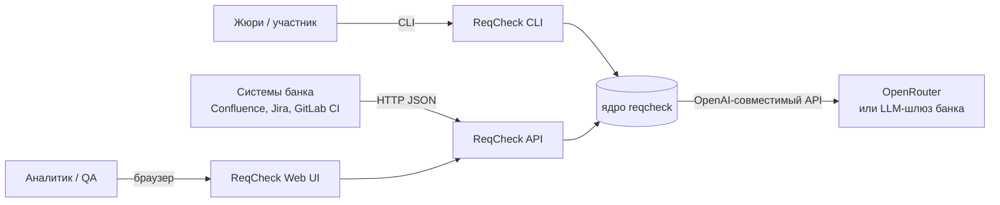
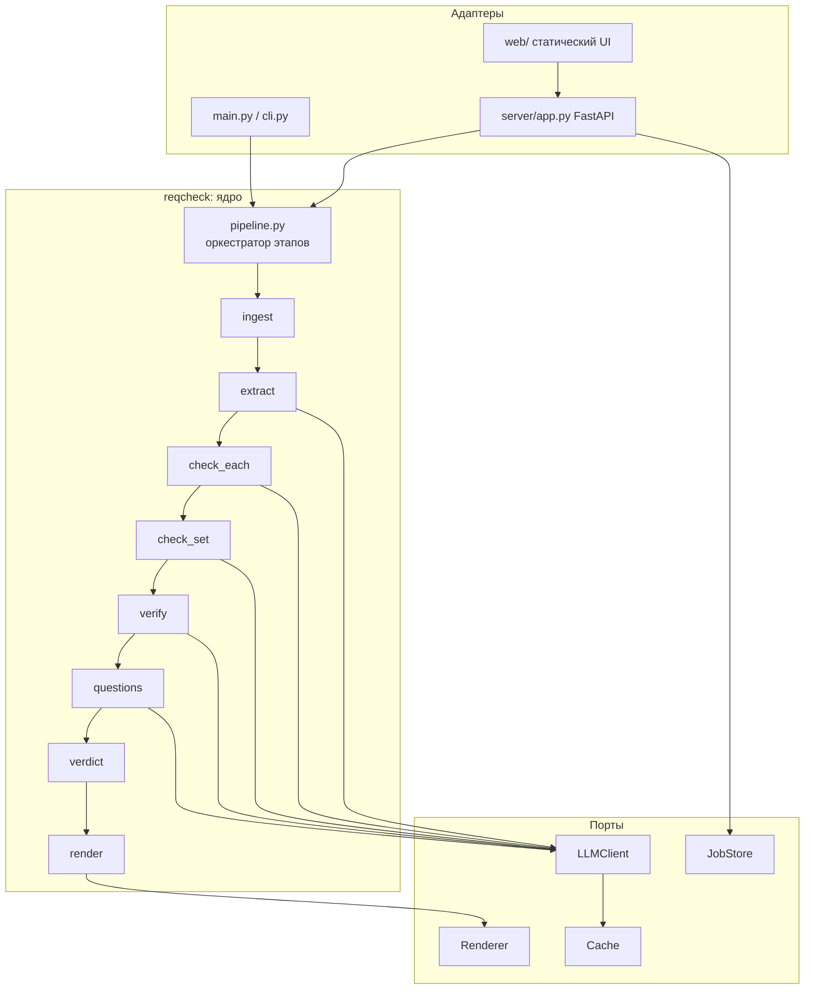
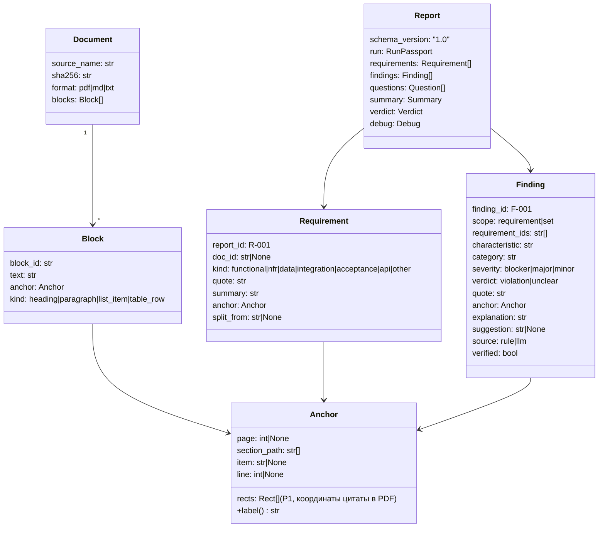
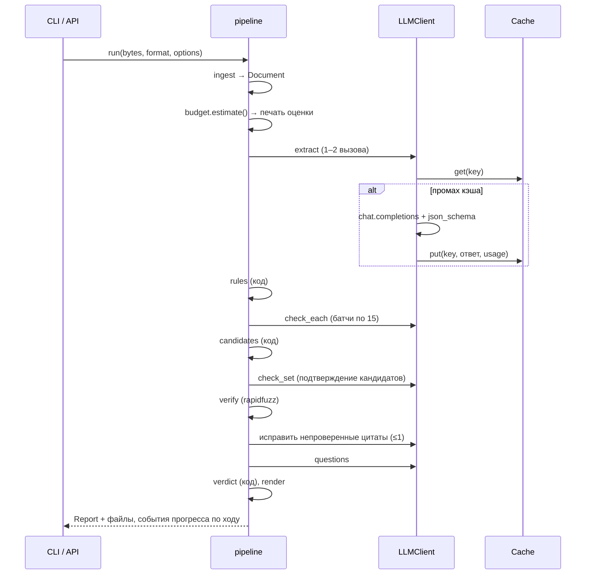

# 03. Архитектура

## 1. Принципы

1. **Ядро без ввода-вывода.** Конвейер — чистая библиотека: на входе байты и тип документа, на выходе `Report`. Файлы, HTTP и браузер — тонкие адаптеры вокруг ядра.
2. **Порты и адаптеры.** Внешние зависимости (LLM, кэш, хранилище заданий, рендеры) подключаются через интерфейсы (`Protocol`). Банк заменяет адаптер, ядро не трогает.
3. **Контракт — JSON.** `Report` (Pydantic) с версией схемы — единственный источник правды. MD, PDF и UI строятся из него.
4. **Модель советует, код решает.** LLM даёт кандидатов и формулировки. Цитаты, счётчики и итоговый вердикт проверяет и считает код.
5. **Ничего не привязано к одному документу.** Эвристики и словари лежат в `config/`, а не в коде.

## 2. Контекст (C4, уровень 1)



## 3. Контейнеры и модули (C4, уровень 2–3)



| Порт | Реализация по умолчанию | Замена в банке |
|---|---|---|
| `LLMClient` | `OpenAICompatClient` (OpenRouter) | Внутренний шлюз через `LLM_BASE_URL`, или свой класс |
| `Cache` | `FileCache` (диск) | Redis, S3, отключение |
| `JobStore` | `InMemoryJobStore` (один процесс) | Redis/БД при нескольких репликах |
| `Renderer` | `MarkdownRenderer`, `PdfRenderer`, `JsonRenderer`; P1: `AnnotatedSourceRenderer` (исходник с пометками), `SnippetRenderer` (фрагмент страницы с подсветкой) | `DocxRenderer` (P1), `ConfluenceRenderer` |
| `Ingestor` | `PdfIngestor`, `MarkdownIngestor`, `TextIngestor` | `DocxIngestor` (P1), `ConfluenceIngestor` |

Реестр ингесторов и рендеров — словарь `расширение → класс`. Новый формат добавляется одним классом без правок конвейера.

## 4. Модель данных (основные сущности)



`Anchor.label()` даёт человекочитаемую ссылку: `стр. 3 › 4.2 Функциональные требования › Ф-2` для PDF и `Часть A › Функциональные требования › Ф-2 (строка 38)` для MD.

## 5. Последовательность прогона



Бюджетный предохранитель проверяется перед каждым вызовом LLM. При превышении оставшиеся LLM-этапы пропускаются, отчёт помечается как неполный.

## 6. HTTP API и задания

- Прогон длится минуты, поэтому API асинхронный: `POST` создаёт задание, прогресс идёт по SSE, результат забирается отдельно.
- MVP: задания выполняются в пуле потоков (`max_workers=2`) внутри процесса, статус хранится в памяти. Этого хватает для одного экземпляра.
- Масштабирование: заменить `JobStore` на Redis и вынести воркер в отдельный процесс. Интерфейс тот же.

Эндпоинты описаны в [04-integration.md](04-integration.md).

## 7. Дерево репозитория

```
hackathon/
├── main.py                     # тонкая обёртка: from reqcheck.cli import main
├── pyproject.toml  uv.lock  requirements.txt  .python-version
├── README.md  CLAUDE.md  .env.example  .gitignore  Dockerfile (P1)
├── config/
│   ├── criteria.yaml  lexicon.yaml  thresholds.yaml
│   ├── completeness.yaml  models.yaml  ingest.yaml
├── reqcheck/
│   ├── __init__.py             # публичный API: validate(), Report
│   ├── cli.py  pipeline.py  settings.py  budget.py  events.py
│   ├── schemas/                # Pydantic: document, requirement, finding, report
│   ├── ingest/                 # __init__.py (ingest), markdown.py (MD/TXT и страницы PDF), pdf.py, normalize.py
│   ├── stages/                 # extract, rules, check_each, check_set, verify, questions, verdict
│   ├── llm/                    # base.py (Protocol), openai_compat.py, cache.py, retry.py
│   ├── render/                 # markdown.py, pdf.py, json.py, templates/*.j2, fonts/*.ttf
│   ├── prompts/                # *.md с версией
│   ├── server/                 # app.py (FastAPI), jobs.py
│   ├── web/                    # index.html, app.css, app.js, fonts/
│   └── eval/                   # __main__.py, matching.py, baseline.py
├── tests/
│   ├── fixtures/               # make_fixtures.py, *.pdf, expected.yaml
│   └── test_*.py
├── eval/results/               # таблицы для презентации (коммитим только итоговые)
└── docs/                       # эти документы
```

## 8. Архитектурные риски

| Риск | Вероятность | Мера |
|---|---|---|
| ~~`pymupdf.Story` не подхватит TTF с кириллицей через `@font-face`~~ | снят | Проверено: TTF через `Archive` работают. woff2 FreeType в PyMuPDF не читает, поэтому `render/fonts/*.ttf` собраны из `web/fonts/*.woff2` с помощью fontTools (разово, не в рантайме). Лицензии OFL лежат рядом |
| Провайдер на OpenRouter игнорирует `strict` у схемы | средняя | `require_parameters`, валидация Pydantic, один повтор с ошибкой |
| Таблицы в PDF разваливаются при извлечении | средняя | Markdown-таблицы от pymupdf4llm + запасной разбор строк по `|` |
| Модель без `temperature` даёт разные ответы | высокая | Кэш; вердикт и счётчики считает код |
| Длинный документ (> 100 требований) | низкая на хакатоне | Батчи, кандидаты противоречий кодом (не O(n²) в LLM) |
